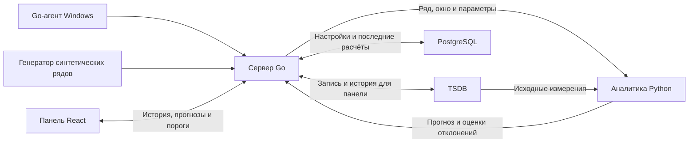

# Архитектура платформы

Платформа состоит из агента Windows, серверной части Go, аналитического компонента Python и веб-интерфейса React. Прогнозы пересчитываются в фоне. Запись и выдача истории работают через сервер Go, а Python читает окна измерений непосредственно из TSDB. Это стартовый вариант, который предстоит сравнить с передачей окон через Go.

## Поток измерений

1. Windows-агент собирает показатели и отправляет пакеты на сервер. Генератор использует тот же вход. Если поступит внешняя выгрузка, её можно будет преобразовать в тот же формат при импорте.
2. Сервер проверяет идентификаторы, метрики, временные метки и значения. Он группирует запись по размеру пакета и времени ожидания. Лимит буфера ограничивает число элементов в памяти.
3. Сервер подтверждает запись после успешного ответа TSDB на запись пакета. Семантику подтверждения и повторной записи проверяем для выбранной базы. При неуспешной отправке источник повторяет передачу в пределах своего буфера.
4. При временном сбое возраст точки в буфере отсчитывается с момента постановки в очередь. Так у исторических точек, если появится импорт, есть то же время на доставку. Лимит хранения и счётчик отброшенных точек действуют на каждом участке с буфером. Порядок вытеснения и численные размеры очередей уточняем на первом стенде.

## Модель данных и контракты

| Объект | Состав и правила |
| --- | --- |
| Ряд | Идентификатор сервера, имя метрики и при необходимости идентификатор логического процессора, файловой системы или дискового устройства. Единица и допустимые измерения описаны в каталоге метрик. |
| Измерение | Идентификатор ряда, время измерения в UTC и числовое значение. Пара ряда и времени определяет точку. Повтор того же измерения сохраняет одну точку. Поведение при разных значениях для одной пары уточняем при выборе TSDB. |
| Запрос на расчёт | Идентификатор ряда, границы окна истории, горизонт и параметры расчёта. Чтение TSDB сосредоточено в модуле доступа к истории на Python. |
| Результат расчёта | Идентификатор ряда, время расчёта, граница использованной истории, прогнозные точки, оценки отклонений и статус. Панель по статусу отличает готовый и устаревший прогноз от отсутствия достаточной истории. |
| Правило предупреждения | Ряд, тип предупреждения, порог и признак включения. Для перегрузки применяется уровень ресурса, для аномалии величина отклонения от ожидаемого значения. |

Каталог метрик уточнит семантику показателей Windows и формулу скорости для накопительных дисковых счётчиков. Сброс счётчика, отсутствие предыдущей точки и пропуск измерения учитываются до анализа скорости. Python готовит полученный ряд к расчёту и учитывает пропуски. Правила подготовки проверяем на сценариях с нерегулярными измерениями.

## Прогнозы и панель

Go запускает пересчёт и ограничивает число одновременных заданий, чтобы чтение истории и вычисления оставляли ресурсы для записи. Python запрашивает исходные измерения в нужном окне. Для графика можно запрашивать меньше точек в зависимости от периода просмотра. Go сохраняет последний успешный расчёт в PostgreSQL. Если очередной расчёт не удался, панель показывает время последнего успешного расчёта. По истечении допустимого срока она помечает предыдущий результат как устаревший.

React меняет линии порога и отметки на уже загруженном графике по мере движения слайдера. Сохранённое правило применяет Go. Прогноз и оценки отклонений можно использовать повторно при смене порога. Проверка согласованности охватывает в том числе точное совпадение значения с порогом.

PostgreSQL хранит учётную запись администратора, правила предупреждений, конфигурацию и последние результаты расчёта. Redis рассматриваем для кэширования повторяющихся запросов к истории. Место кэша и срок жизни записей выбираем по результатам измерений.

За статусами решений следим в [DECISIONS.md](DECISIONS.md).
